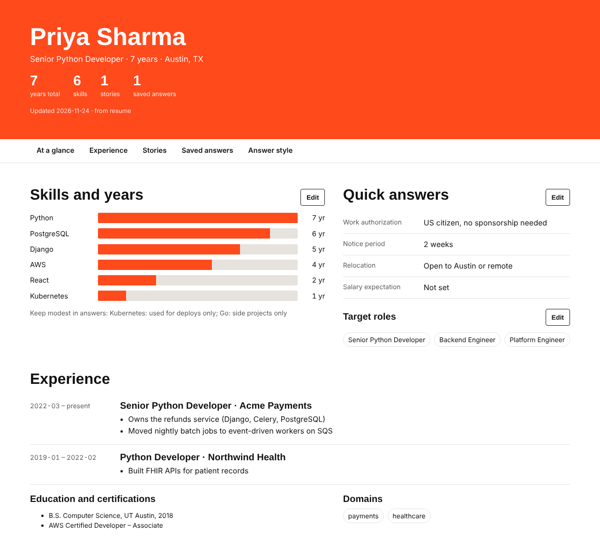

# say-it-like-me

A Claude skill that answers interview questions the way **you** would say them: first person, 30-60 seconds out loud, and built from your own resume instead of textbook definitions. It works for any role and any stack: software, data, QA, DevOps, cloud, product, analysis.

Paste a question an interviewer asked (or might ask) and you get the answer to practise saying. It also runs mock interviews, drills a topic and preps you from a job description. Your details are saved once in a private **Interview Profile** dashboard, so every later chat already knows your background, and you can open it any time to check or edit them.

> **Q:** How do you handle a downstream service that's slow or down?
>
> The first thing I set is a timeout, because without one a slow dependency ties up our threads and takes us down with it. Then I put a circuit breaker around the call, with a small retry and backoff, but only when the call is idempotent. On our notifications service, when the SMS provider got slow we queued the message to retry later, so the customer's request still went through. And I alert on the breaker opening, so we hear about it before customers do.
>
> Follow-up they may ask: How do you make the retried call idempotent?



*The Interview Profile dashboard (sample data). Yours is private to you until you share it.*

## Set up (about 5 minutes, once)

| Step | What to do | Where |
|---|---|---|
| 1. Get the skill | Download [`dist/interview-answers.zip`](dist/interview-answers.zip). Don't unzip it. | This page |
| 2. Install it | Open **Customize > Skills**, upload the zip as it is, and make sure it's turned on. | Claude (web, desktop or app) |
| 3. Turn on what it uses | In Claude's settings, make sure **code execution** (reads your resume, gets updates) and **artifacts** (your dashboard) are on. | Claude settings |
| 4. Create your profile | Start a new chat, attach your resume (PDF or Word, or paste it), and say the setup prompt below. Answer the five short questions Claude asks. | New Claude chat |
| 5. Check your dashboard | Open the link Claude gives you. Fix anything that's off right on the page, or tell Claude. | Your Interview Profile |
| 6. Add your stories (recommended) | Say the stories prompt below and tell Claude the real details of 4-6 situations from your work. | Same or new chat |
| 7. Practise | Paste any interview question. That's it. | Any chat |

Works on any Claude plan that has skills, including Free.

## First prompts

Say these once, in this order. The bold part is what matters; the rest can be your own words.

| When | Say | What happens |
|---|---|---|
| Setup (attach your resume) | **Set up my interview profile.** | Claude reads your resume and asks, in one message, what it can't tell: target roles, years per main skill, skills to keep modest, screening answers (work authorization, notice period, relocation, salary if you want) and answer style (short / standard / detailed, follow-up line on or off, coding language). Then it creates your private dashboard and saves everything there. |
| Right after | **Set up my interview stories.** | Claude suggests 5-7 stories from your experience (a production problem, a disagreement, a tight deadline, a mistake, mentoring...), asks you for the real details, and saves them for "tell me about a time..." questions. |
| Check it worked | **What's my notice period and which roles am I targeting?** | Answers straight from your saved profile. |

The questions Claude asks during setup:

| # | Question | Example answer |
|---|---|---|
| 1 | Target roles and level | Senior Backend Engineer, Platform Engineer |
| 2 | Years per main skill (pre-filled from your resume; change any) | Python 7, AWS 4, React 2 |
| 3 | Anything to keep modest | Kubernetes: deploys only |
| 4 | Screening answers | US citizen; 2 weeks notice; remote or Austin; salary: skip |
| 5 | Answer style | Short, follow-ups on, Python for coding |

Say **"use the defaults"** to keep what Claude pre-filled.

## Everyday prompts

| Say | What you get |
|---|---|
| *How do I answer: "What's the difference between a process and a thread?"* (or just paste the question) | The spoken answer in your voice |
| Several questions, or a screenshot of them | Each one numbered and answered |
| *Interview me for a senior backend role* | A mock interview: one question at a time, feedback on your answer, then "Say it like this:" with the polished version |
| *Give me 10 SQL questions with answers* | A drill: question and answer pairs, most likely first |
| Paste a job description | The 8-10 questions it most likely leads to, with answers, and your biggest gap to prepare |
| *Save this answer* | The last answer is saved to your dashboard's Saved answers |
| *Update my interview profile: notice period is 30 days* | That field changes on your dashboard |
| *Here's my new resume, update my interview profile* | Claude shows what changed and saves it after you confirm |
| *Where's my interview dashboard?* | The link |

Change the style any time: *"longer answers"*, *"no follow-ups"*, *"code in Go"*. Add "always" and it's saved to your profile.

## What it won't do

- Invent employers, projects or numbers. If a story needs a figure you haven't given, it leaves `[your number]` for you to fill in.
- Oversell a skill. Asked about something your resume doesn't show, it answers honestly and bridges to your closest real experience, because that's what survives the interviewer's follow-up.
- Share your details. The dashboard is a private artifact in your own Claude account; nothing personal goes into this repo.

## Getting updates

You don't have to do anything. The first time the skill runs in a chat it checks this repo's version (a few bytes). When there's a newer one, that chat uses it and tells you once:

> UPDATE: your installed interview-answers skill is 1.0.0 and the latest is 1.1.0; this chat uses 1.1.0. ...

To stop the download in every chat, download [`dist/interview-answers.zip`](dist/interview-answers.zip) again and upload it in Customize > Skills, replacing the old one. Your profile, stories and saved answers live in your dashboard, so an update never touches them. If the dashboard's design changes, Claude offers once to refresh it; your data stays.

If GitHub can't be reached, your installed copy is used. To allow updates, keep `github.com`, `raw.githubusercontent.com` and `codeload.github.com` allowed in Claude's code-execution network settings.

## Making a change (maintainer)

1. Edit files under `skills/interview-answers/` (add questions to `references/question-bank.md`, tune `references/voice.md`, and so on).
2. Bump `skills/interview-answers/VERSION` and the `Version:` line in its SKILL.md to the same value (1.1.0 → 1.1.1 for small fixes, 1.2.0 for new features). If you change `assets/dashboard.html`, also bump `assets/dashboard.version`.
3. Add a `## interview-answers <version>` entry at the top of `CHANGELOG.md`.
4. Run `python3 tools/build.py`. It checks the versions match and rebuilds `dist/interview-answers.zip`.
5. Commit and push to `main`. Friends get it in their next chat.

## Layout

```
skills/interview-answers/
  SKILL.md            the instructions: modes, answer shapes, voice and honesty rules
  VERSION             compared with the installed copy by update.sh
  update.sh           once per chat: uses the newest version from this repo
  assets/
    dashboard.html    the Interview Profile page each person gets (data lives in its database)
    dashboard.version template number, for refresh offers
  references/
    setup.md          the setup questions, stories, profile updates
    profile-store.md  the dashboard's database and how Claude reads and writes it
    voice.md          good vs bad answers; the style to match
    coding.md         coding answers in any language, plus SQL and frameworks
    behavioral.md     stories, "tell me about yourself", HR and screening answers
    system-design.md  spoken design walk-through and frequent prompts
    question-bank.md  questions by role and stack for mocks and drills
  evals/evals.json    test prompts (not shipped in the zip)
dist/interview-answers.zip   what friends install
docs/dashboard.png           the screenshot above
tools/build.py               checks + zip build
```
